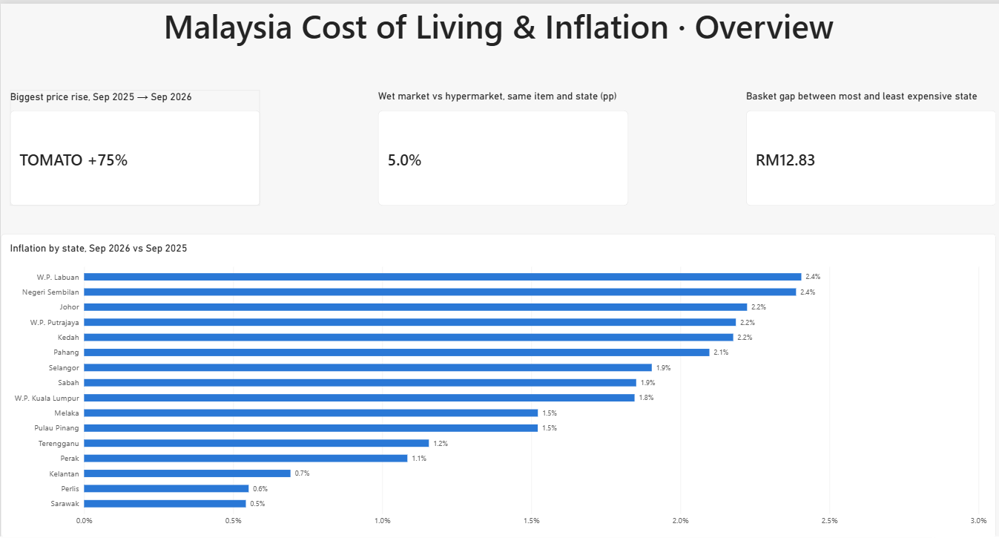
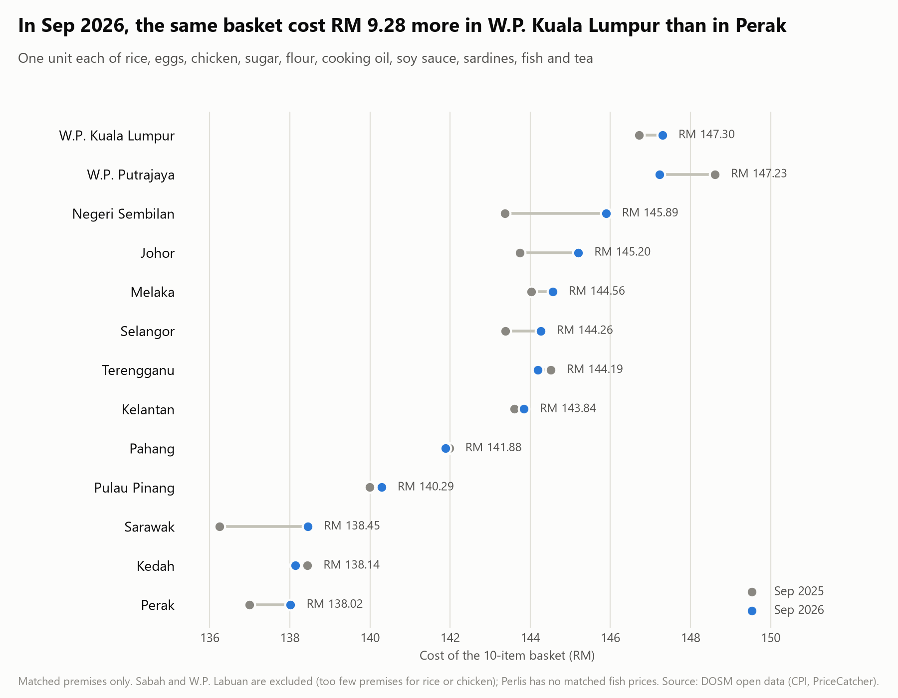
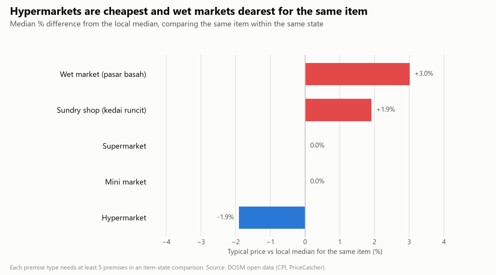
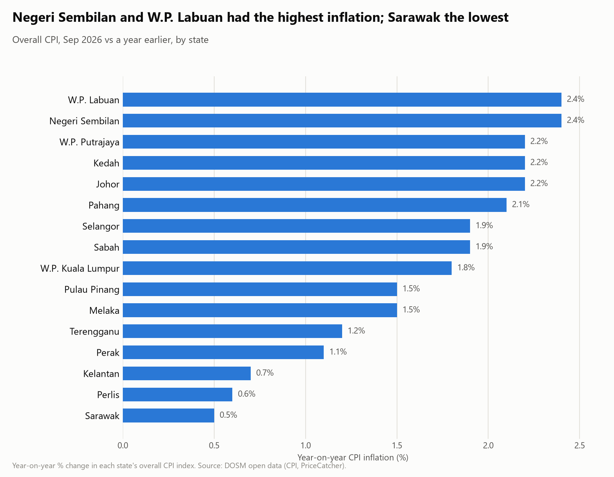
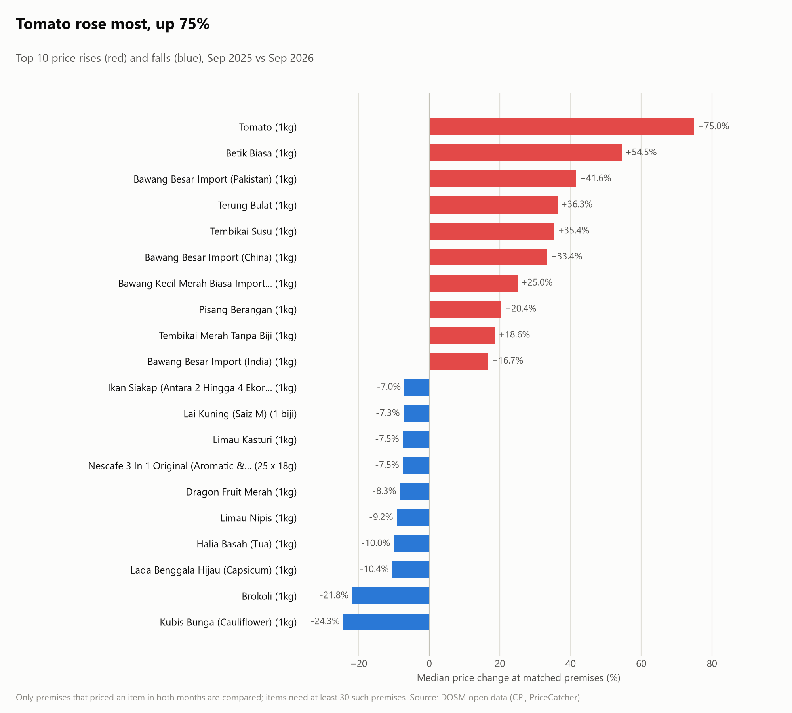
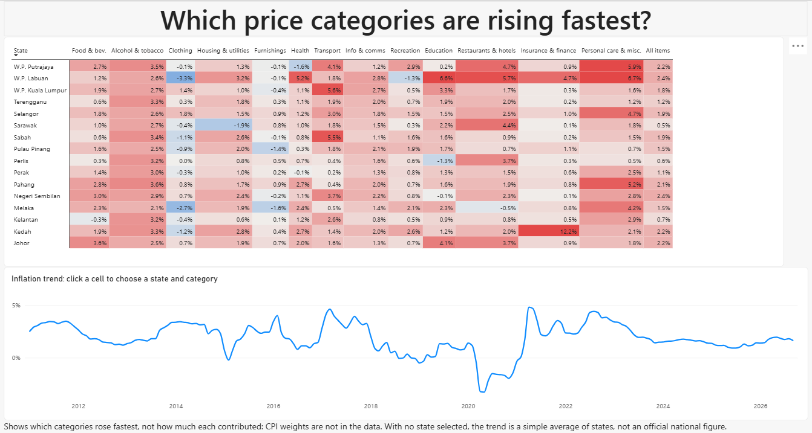
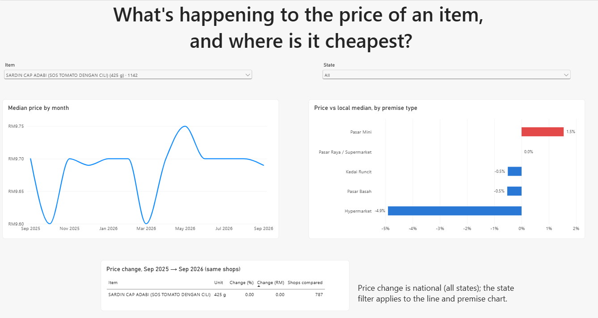
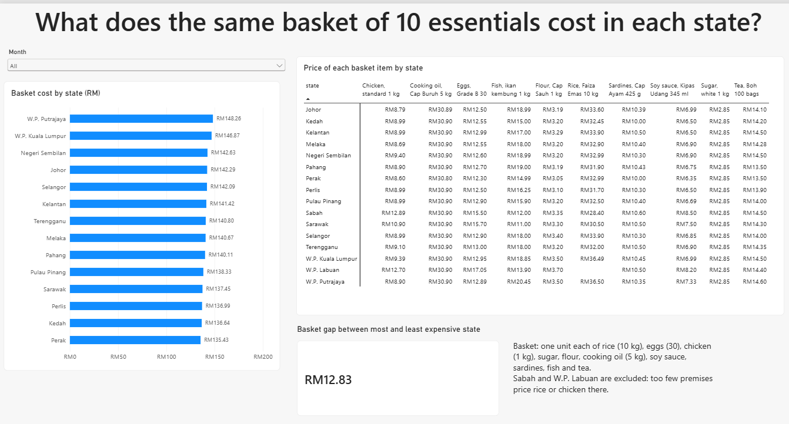
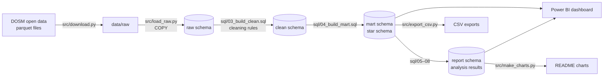

# Malaysia Cost of Living & Inflation Dashboard

An end-to-end analysis of Malaysian inflation and everyday prices, from official DOSM open data to a PostgreSQL star schema, SQL analysis and a Power BI dashboard. It covers **22 million daily prices** from **September 2025 to September 2026** and state-level CPI from 2010.



## Key findings

**1. The same basket of 10 everyday essentials costs RM 12.83 (about 9%) more in Putrajaya than in Perak.**
Over the 13 months, the basket (rice, eggs, chicken, sugar, flour, cooking oil, soy sauce, sardines, fish and tea) averaged RM 148.26 in W.P. Putrajaya and RM 135.43 in Perak.



**2. For the same item in the same state, hypermarkets are usually the cheapest place to shop and wet markets the most expensive.**
Hypermarkets typically charge 1.9% below the local median and wet markets 3.0% above. For dry produce like onions, garlic and potatoes, the gap is over 30 percentage points (−12.6% vs +19.2%).



**3. Inflation in September 2026 ranged from 2.4% in Negeri Sembilan and W.P. Labuan to 0.5% in Sarawak.**
Some states saw prices rise nearly five times faster than others. Kedah's insurance and financial services rose 12.2%, a sustained climb through 2025–2026 rather than a one-off.



**4. Fresh produce moved the most.**
Tomatoes ended the year 75% dearer, after swinging between about RM 3.50 and RM 9 per kg during the year, while cauliflower (−24%) and broccoli (−22%) got cheaper.



More detail: [inflation by state and category heatmap](outputs/charts/q1_category_heatmap.png).

## Research questions

1. Which states have the highest and lowest recent inflation, and which CPI categories are rising fastest?
2. Which everyday items rose or fell most in price?
3. Do prices for the same item differ by premise type (hypermarket, supermarket, mini market, sundry shop, wet market)?
4. How much does a fixed basket of essentials cost in each state, and how has it changed?

## Dashboard

A four-page Power BI dashboard ([`dashboard/cost_of_living.pbix`](dashboard/cost_of_living.pbix)) connects directly to the PostgreSQL star schema. Every page was checked against the SQL results.

| Page | What it shows |
|---|---|
| **Overview** | Inflation by state, plus headline cards for the biggest price rise, the wet market vs hypermarket gap and the basket gap |
| **Category drill-down** | A state × category inflation matrix; clicking a cell shows that rate's trend since 2011 |
| **Item price tracker** | For any item: its monthly price, its year-on-year change and where it is cheapest by premise type |
| **Basket comparison** | Basket cost by state and the price of each basket item in each state, for any month |

| Category drill-down | Item price tracker | Basket comparison |
|---|---|---|
|  |  |  |

The dashboard uses a hybrid approach: interactive DAX for inflation and basket cost, and saved SQL tables for the more complex item and premise type comparisons, so the dashboard and the SQL always agree. Two of the key measures:

```dax
-- Year-on-year inflation: compare this month's CPI with the same month last year
CPI Index Last Year = CALCULATE ( [CPI Index], SAMEPERIODLASTYEAR ( dim_date[date] ) )
Inflation YoY % = DIVIDE ( [CPI Index] - [CPI Index Last Year], [CPI Index Last Year] )

-- Basket cost: add up each basket item's price, where an item's price is the
-- median across shops of each shop's own median price
Basket Cost =
SUMX (
    VALUES ( basket_item[item_code] ),
    VAR ThisItem = basket_item[item_code]
    RETURN CALCULATE ( [Item Price (State Median)], dim_item[item_code] = ThisItem )
)
```

## Data

All data is free, official open data from the Department of Statistics Malaysia (DOSM), downloaded by [`src/download.py`](src/download.py).

| Dataset | Used for | Source |
|---|---|---|
| CPI by state and category (monthly, 2010 onwards) | Inflation (Q1) | [storage.dosm.gov.my/cpi/cpi_2d_state.parquet](https://storage.dosm.gov.my/cpi/cpi_2d_state.parquet) |
| PriceCatcher daily item prices (one file per month) | Item, premise and basket prices (Q2–Q4) | [open.dosm.gov.my PriceCatcher](https://open.dosm.gov.my/data-catalogue/pricecatcher) |
| PriceCatcher item and premise lookups | Item names and units; premise type and state | [lookup_item](https://storage.data.gov.my/pricecatcher/lookup_item.parquet), [lookup_premise](https://storage.data.gov.my/pricecatcher/lookup_premise.parquet) |
| MCOICOP classification | CPI category names | [open.dosm.gov.my/data-catalogue/mcoicop](https://open.dosm.gov.my/data-catalogue/mcoicop) (CC BY 4.0) |

> **Caveat from DOSM:** inflation analysis should use CPI data. PriceCatcher is a supplement for item-level detail, not an inflation measure. This project uses CPI for inflation (Q1) and PriceCatcher only for item, premise and basket prices (Q2–Q4).

## How it works



- **Raw → clean → mart:** each layer is rebuilt only from the one before it, in a single transaction, so the pipeline can be re-run safely and a failure never leaves half-built tables.
- **Star schema:** two fact tables (daily prices, monthly CPI) and five dimensions (date, item, premise, state, CPI category). Prices reach state through the premise, because state is a property of the premise.
- **Tech stack:** Python (pandas, pyarrow, psycopg, Matplotlib, Seaborn), PostgreSQL 18, SQL (CTEs, window functions), Power BI (DAX).

## Methods in brief

- **Inflation** is year-on-year: each month's CPI compared with the same month a year earlier, as DOSM reports it.
- **Fair comparisons:** item price changes compare **the same shops** in both months, so a change in which shops reported can't look like a price change. Premise types are compared **within the same item and state**, so location can't look like a premise type effect.
- **Medians, not averages,** so a few extreme prices can't distort results.
- **Outliers:** prices more than 5× or less than 1/5 of their item's median are removed as data-entry errors (0.019% of rows, e.g. RM 5,390 for 1 kg of shallots).
- **Minimum evidence:** item changes need at least 30 shops priced in both months; premise type comparisons need at least 5 shops per type; a state's basket needs at least 5 shops for every item.

The exploration behind these rules is in [`notebooks/01_explore.ipynb`](notebooks/01_explore.ipynb), and each research question has its own SQL file in [`sql/`](sql/).

## Limitations

- **No CPI weights:** the data shows which categories rose fastest, not how much each contributed to overall inflation.
- **Excluded data:** 1.5% of price rows belong to 17 item codes that DOSM's item lookup doesn't describe yet, so they can't be named. Sabah and W.P. Labuan are excluded from the basket (too few shops price its rice or chicken), and Perlis from the basket's yearly change (no fish prices from the same shops in both months).
- **The basket has no vegetables,** and the 10 kg rice and 5 kg cooking oil make up a large share of its cost.
- **Public holidays** (e.g. Hari Raya, Chinese New Year) have no price data, so festive-day prices aren't captured.
- **Prices, not quality:** premise type comparisons can't account for differences in freshness or quality.
- **One year of item prices:** a single September-to-September comparison can still be affected by volatile items like tomatoes.

## How to run

**Requirements:** Python 3.11+, PostgreSQL (the commands below assume its `bin` folder is on your PATH) and, for the dashboard, Power BI Desktop.

1. Set up Python and your database settings:

   ```bash
   python -m venv .venv
   .venv\Scripts\activate
   pip install -r requirements.txt
   ```

   Copy `.env.example` to `.env` and fill in your PostgreSQL password.

2. Create the database and schemas (once):

   ```bash
   createdb -h localhost -U postgres cost_of_living
   psql -h localhost -U postgres -d cost_of_living -f sql/01_create_schemas.sql
   psql -h localhost -U postgres -d cost_of_living -f sql/02_create_raw_tables.sql
   ```

3. Download the data and build every layer:

   ```bash
   python src/download.py
   python src/load_raw.py
   psql -h localhost -U postgres -d cost_of_living -f sql/03_build_clean.sql
   psql -h localhost -U postgres -d cost_of_living -f sql/04_build_mart.sql
   ```

4. Run the analysis (Q2–Q4 also save their results to the `report` schema for Power BI):

   ```bash
   psql -h localhost -U postgres -d cost_of_living -f sql/05_q1_state_inflation.sql
   psql -h localhost -U postgres -d cost_of_living -f sql/06_q2_item_price_change.sql
   psql -h localhost -U postgres -d cost_of_living -f sql/07_q3_premise_type_prices.sql
   psql -h localhost -U postgres -d cost_of_living -f sql/08_q4_basket_cost.sql
   ```

5. Create the outputs:

   ```bash
   python src/export_csv.py
   python src/make_charts.py
   ```

6. Open `dashboard/cost_of_living.pbix` in Power BI Desktop and select **Refresh**.

To add months, edit `PRICECATCHER_MONTHS` in `src/download.py` and re-run steps 3–5. Every query finds its date range from the data.

## Next steps

- Add DOSM's CPI weights to measure each category's true contribution to inflation.
- Extend PriceCatcher to two or more years to separate lasting price changes from one-off swings.
- Add a state-level map to the dashboard.
- Schedule the pipeline to refresh automatically each month.
